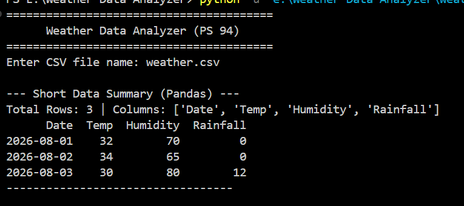
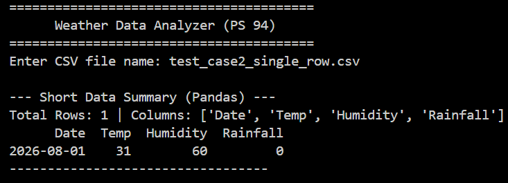
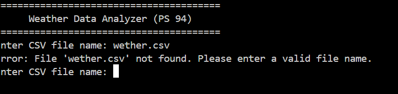
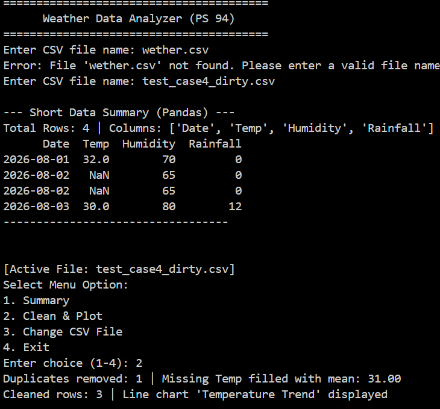

# Weather Data Analyzer (PS No. 94)

[](https://www.python.org/)
[](https://pandas.pydata.org/)
[](https://numpy.org/)
[](https://matplotlib.org/)
[]()

A robust, console-based Python 3 weather analytics and data cleaning system developed under **Problem Statement No. 94**. The program loads daily weather data from CSV files, performs automated data hygiene (deduplication and missing value imputation), performs statistical analysis with NumPy, and renders publication-ready Matplotlib visualizations (line and bar charts).

---

## 📑 Problem Statement & Specifications

- **PS No.:** 94
- **Project Title:** Weather Data Analyzer
- **Problem Statement:** Build a program that loads daily weather data (`date`, `temperature`, `humidity`, `rainfall`) from a CSV file, cleans it, and analyses it to find hottest/coldest days, averages and rainfall trends, with charts.
- **Language:** Python 3
- **Concepts:** Pandas, NumPy, Matplotlib, Data Cleaning
- **CSV Columns:** `Date`, `Temp`, `Humidity`, `Rainfall`

---

## 🚀 Bare Minimum Requirements Compliance

| # | Bare Minimum Requirement | Implementation Detail | Status |
|---|--------------------------|-----------------------|:------:|
| **1** | Write the solution in Python 3 (one `.py` file) and run it from the console | Standalone implementation in [`weather_analyzer.py`](weather_analyzer.py) with console interactive menu and CLI arguments | **PASS** |
| **2** | Load the CSV file using Pandas and show a short data summary | Handled via `load_weather_data()` and `show_pandas_summary()` displaying shape and preview | **PASS** |
| **3** | Clean the data (handle missing values and duplicates) | Handled via `clean_and_plot()`: removes duplicate records and fills missing temperatures with the NumPy mean | **PASS** |
| **4** | Use NumPy to calculate mean, maximum, minimum and standard deviation | Evaluated via `np.mean()`, `np.max()`, `np.min()`, `np.std()`, and `np.sum()` | **PASS** |
| **5** | Plot at least two Matplotlib charts (line and bar) with title and labels | Line chart (`temperature_trend.png`) and Bar chart (`rainfall_trend.png`) generated and saved | **PASS** |

---

## 📂 Project Directory Structure

```text
Weather Data Analyzer/
│
├── weather_analyzer.py        # Core standalone solution (Requirement 1)
├── main.py                    # Application launcher delegating to weather_analyzer.py
├── requirements.txt           # Project dependencies (pandas, numpy, matplotlib)
├── README.md                  # Comprehensive project documentation
├── SUMMARY.md                 # Technical summary & verification report
│
├── weather.csv                # Test Case 1 CSV (Normal input)
├── test_case2_single_row.csv  # Test Case 2 CSV (Boundary / Minimum 1 row)
├── test_case4_dirty.csv       # Test Case 4 CSV (Missing values & duplicate rows)
│
├── temperature_trend.png      # Matplotlib Line Chart (Temperature Trend)
├── rainfall_trend.png         # Matplotlib Bar Chart (Daily Rainfall Trend)
├── test_case_1_screenshot.png # Terminal execution screenshot for Test Case 1
├── test_case_2_screenshot.png # Terminal execution screenshot for Test Case 2
├── test_case_3_screenshot.png # Terminal execution screenshot for Test Case 3
└── test_case_4_screenshot.png # Terminal execution screenshot for Test Case 4
```

---

## ⚙️ Installation & Setup

### Prerequisites
- Python 3.8+ (Tested on Python 3.14)
- `pip` package manager

### 1. Clone or Navigate to Directory
```bash
cd "Weather Data Analyzer"
```

### 2. Install Required Dependencies
```bash
pip install -r requirements.txt
```

*Contents of `requirements.txt`:*
- `pandas>=2.0.0`
- `numpy>=1.24.0`
- `matplotlib>=3.7.0`

---

## 🖥️ How to Run

### Mode A: Interactive Console Mode
Run the standalone script or `main.py` directly:
```bash
python weather_analyzer.py
```
Or:
```bash
python main.py
```

**Interactive Prompts:**
1. Enter CSV file name (e.g., `weather.csv`).
2. A Pandas summary of the loaded records is shown.
3. Select an option from the menu:
   - `1` : Summary Statistics
   - `2` : Clean Data & Plot Visualizations
   - `3` : Change CSV File (switch active dataset without restarting)
   - `4` : Exit

---

### Mode B: Direct CLI Execution (For Scripts & Evaluation)
You can directly pass the CSV filename and menu choice as command line arguments:

```bash
# Test Case 1: Normal summary
python weather_analyzer.py weather.csv 1

# Test Case 2: Boundary single row
python weather_analyzer.py test_case2_single_row.csv 1

# Test Case 3: Invalid file test
python weather_analyzer.py wether.csv

# Test Case 4: Data cleaning & plotting
python weather_analyzer.py test_case4_dirty.csv 2
```

---

## 🧪 Verified Test Cases & Expected Outputs

### Test Case 1: Normal Input
- **CSV (`weather.csv`):**
  ```csv
  2026-08-01,32,70,0
  2026-08-02,34,65,0
  2026-08-03,30,80,12
  ```
- **Menu Option:** `1` (Summary)
- **Expected Output:**
  ```text
  Average Temp: 32.00 C | Max: 34 (2026-08-02) | Min: 30 (2026-08-03) | Total Rainfall: 12 mm
  ```
- **Execution Proof:**
  

---

### Test Case 2: Boundary / Minimum Input (Single Row)
- **CSV (`test_case2_single_row.csv`):**
  ```csv
  2026-08-01,31,60,0
  ```
- **Menu Option:** `1` (Summary)
- **Expected Output:**
  ```text
  Average Temp: 31.00 C | Max: 31 | Min: 31 | Std Dev: 0.00
  ```
- **Execution Proof:**
  

---

### Test Case 3: Invalid Input (File Not Found)
- **File Name:** `wether.csv` (Non-existent)
- **Expected Output:**
  ```text
  Error: File 'wether.csv' not found. Please enter a valid file name.
  ```
- **Execution Proof:**
  

---

### Test Case 4: Different Valid Scenario (Dirty Data Cleaning & Plotting)
- **CSV (`test_case4_dirty.csv`):**
  ```csv
  2026-08-01,32,70,0
  2026-08-02,,65,0
  2026-08-02,,65,0
  2026-08-03,30,80,12
  ```
- **Menu Option:** `2` (Clean & Plot)
- **Expected Output:**
  ```text
  Duplicates removed: 1 | Missing Temp filled with mean: 31.00
  Cleaned rows: 3 | Line chart 'Temperature Trend' displayed
  ```
- **Execution Proof:**
  

---

## 📊 Matplotlib Visualizations Generated

When Option 2 (**Clean & Plot**) is executed, the program renders:

1. **Line Chart (`temperature_trend.png`):**
   - **X-axis:** Date
   - **Y-axis:** Temperature (°C)
   - **Features:** Point markers, temperature callout labels, dashed grid lines, and styled red line `#e74c3c`.

2. **Bar Chart (`rainfall_trend.png`):**
   - **X-axis:** Date
   - **Y-axis:** Rainfall (mm)
   - **Features:** Blue gradient bars `#3498db`, border stroke `#2980b9`, rainfall data annotations, and y-axis grid.

---

## 🛡️ Key Implementation Details

1. **Smart Header Detection:**
   Can parse CSVs with or without explicit headers (`Date,Temp,Humidity,Rainfall`). If raw data is provided, column names are automatically assigned and standardized.

2. **Strict NumPy Calculations:**
   Avoids high-level abstractions where low-level NumPy vector arrays are requested:
   - Mean: $\mu = \frac{1}{N}\sum x_i \rightarrow$ `np.mean(temps)`
   - Max & Min: `np.max(temps)`, `np.min(temps)`
   - Standard Deviation: $\sigma = \sqrt{\frac{1}{N}\sum (x_i - \mu)^2} \rightarrow$ `np.std(temps)`
   - Total Rainfall: `np.sum(rainfalls)`

3. **Defensive Error Handling:**
   - Graceful file absence handling without unhandled tracebacks.
   - Robust missing value imputation using clean non-null means.
   - Non-blocking headless Matplotlib rendering fallback.
