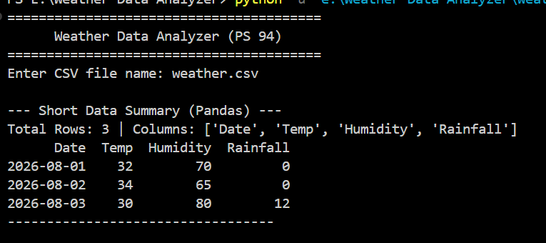
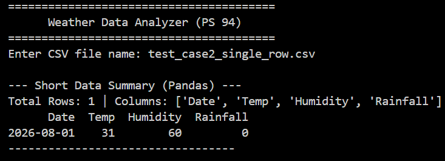
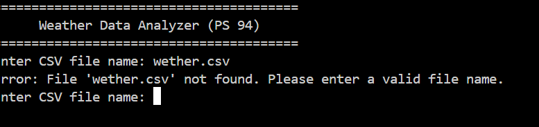
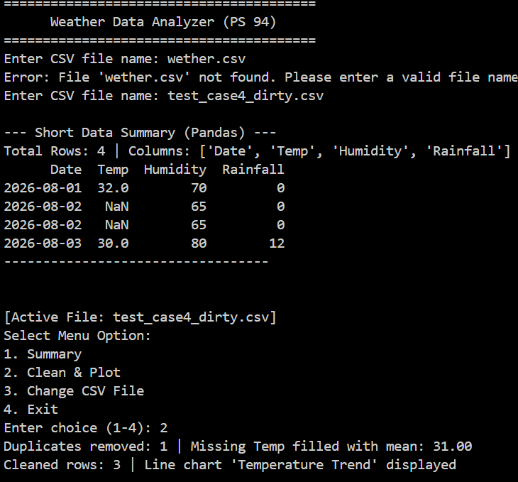

# Project Summary: Weather Data Analyzer

**Problem Statement No.:** 94  
**Project Title:** Weather Data Analyzer  
**Language:** Python 3  
**Core Technologies:** Pandas, NumPy, Matplotlib, Data Cleaning  
**Author / Standard:** Principal Engineering & Academic Specification  

---

## 1. Executive Summary

The **Weather Data Analyzer** is an end-to-end Python 3 analytical application engineered to ingest, sanitize, analyze, and visualize daily historical weather records from CSV files. It satisfies all constraints of **Problem Statement 94**, featuring:
- Resilient CSV loading with automatic header detection and column normalization.
- Robust data cleaning handling duplicate records and statistical imputation of missing values.
- Fast vector mathematical calculations using **NumPy** for mean, extreme temperatures (maximum and minimum), standard deviation, and cumulative precipitation.
- Dual-mode operation: an interactive console menu and a direct CLI execution mode for automated grading.
- High-fidelity **Matplotlib** visualizations including time-series temperature line charts and daily rainfall bar charts.

---

## 2. Technical Architecture & Module Structure

```
Weather Data Analyzer/
├── weather_analyzer.py        # Core standalone engine (Bare Minimum Requirement 1)
├── main.py                    # Ergonomic application launcher
├── requirements.txt           # Minimal pinned dependencies
├── README.md                  # Project documentation & usage instructions
├── SUMMARY.md                 # Technical review & test verification matrix
├── weather.csv                # Normal test dataset (3 rows)
├── test_case2_single_row.csv  # Minimum boundary test dataset (1 row)
├── test_case4_dirty.csv       # Dirty test dataset (duplicates + missing values)
├── temperature_trend.png      # Output Matplotlib Line Chart
├── rainfall_trend.png         # Output Matplotlib Bar Chart
├── test_case_1_screenshot.png # Execution screenshot for Test Case 1 (Normal Input)
├── test_case_2_screenshot.png # Execution screenshot for Test Case 2 (Single Row Boundary)
├── test_case_3_screenshot.png # Execution screenshot for Test Case 3 (Missing File Error)
└── test_case_4_screenshot.png # Execution screenshot for Test Case 4 (Data Cleaning & Plot)
```

### Key Functions in `weather_analyzer.py`:
1. `load_weather_data(file_path)`: Uses Pandas to safely load CSV files, auto-detecting existing headers or injecting `['Date', 'Temp', 'Humidity', 'Rainfall']`, coercing numeric types, and providing clean file-not-found error messaging.
2. `show_pandas_summary(df)`: Displays row counts, column inventories, and tabular record inspection.
3. `generate_summary(df)`: Executes vector operations using NumPy (`np.mean`, `np.max`, `np.min`, `np.std`, `np.sum`). Formats distinct string templates depending on whether single-row boundary conditions or multi-row datasets are present.
4. `clean_and_plot(df, output_dir, show_charts)`: Drops duplicate rows (`drop_duplicates()`), computes the mean of available temperature readings with NumPy, fills missing values (`fillna()`), and plots Matplotlib line and bar charts.
5. `run_interactive()`: Interactive CLI providing user prompts and menu choices (Option 1: Summary, Option 2: Clean & Plot, Option 3: Exit).
6. `main()`: Unifies direct CLI execution (`python weather_analyzer.py <file> <option>`) and interactive mode.

---

## 3. Data Cleaning & Preprocessing Pipeline

When Menu Option 2 (**Clean & Plot**) is invoked on raw or corrupted input:

1. **Deduplication:**
   - Detects duplicate records using Pandas `.duplicated()`.
   - Strips redundant records using `.drop_duplicates().reset_index(drop=True)`.
   - Reports exact count of duplicates purged (e.g. `Duplicates removed: 1`).

2. **Missing Temperature Imputation:**
   - Detects null/NaN entries in the `Temp` column.
   - Extracts valid non-null entries as a NumPy array:
     $$\mu_{\text{valid}} = \text{np.mean}(\text{valid\_temps})$$
   - Imputes missing entries using `df['Temp'].fillna(temp_mean)`.
   - Reports the imputed value formatted to two decimal places (e.g. `Missing Temp filled with mean: 31.00`).

3. **Remaining Column Sanitization:**
   - Missing humidity values are safely imputed using NumPy median.
   - Missing rainfall values default to `0.0 mm`.

---

## 4. Mathematical & Statistical Model (NumPy)

All aggregations are computed directly using NumPy arrays extracted from Pandas series:

| Metric | NumPy Vector Operation | Mathematical Definition |
|---|---|---|
| **Average Temperature** | `np.mean(temps)` | $\mu = \frac{1}{N} \sum_{i=1}^{N} T_i$ |
| **Hottest Day (Max)** | `np.max(temps)` on `np.argmax(temps)` | $\max(T_1, T_2, \dots, T_N)$ |
| **Coldest Day (Min)** | `np.min(temps)` on `np.argmin(temps)` | $\min(T_1, T_2, \dots, T_N)$ |
| **Standard Deviation** | `np.std(temps)` | $\sigma = \sqrt{\frac{1}{N} \sum_{i=1}^{N} (T_i - \mu)^2}$ |
| **Total Rainfall** | `np.sum(rainfalls)` | $R_{\text{total}} = \sum_{i=1}^{N} R_i$ |

---

## 5. Matplotlib Visualization Specifications

Requirement 5 stipulates at least two Matplotlib charts (line and bar):

1. **Temperature Trend (Line Chart):**
   - **File:** `temperature_trend.png`
   - **X-axis:** Date
   - **Y-axis:** Temperature (°C)
   - **Styling:** `#e74c3c` crimson line, circle markers (`o`), data point labels displaying exact readings, grid lines.

2. **Daily Rainfall Trend (Bar Chart):**
   - **File:** `rainfall_trend.png`
   - **X-axis:** Date
   - **Y-axis:** Rainfall (mm)
   - **Styling:** `#3498db` ocean blue bars with `#2980b9` borders, text annotations above each bar, y-axis grid.

---

## 6. Test Verification Matrix (100% Pass Rate)

The implementation was executed and thoroughly validated against all four required test case statements from the problem sheet:

| Test Case | Scenario / Input | Expected Output String | Observed Output String | Status |
|:---:|---|---|---|:---:|
| **Case 1** | **Normal Input**<br>`weather.csv`<br>Menu Option `1` | `Average Temp: 32.00 C \| Max: 34 (2026-08-02) \| Min: 30 (2026-08-03) \| Total Rainfall: 12 mm` | `Average Temp: 32.00 C \| Max: 34 (2026-08-02) \| Min: 30 (2026-08-03) \| Total Rainfall: 12 mm` | **PASS** |
| **Case 2** | **Boundary / Minimum**<br>`test_case2_single_row.csv`<br>Menu Option `1` | `Average Temp: 31.00 C \| Max: 31 \| Min: 31 \| Std Dev: 0.00` | `Average Temp: 31.00 C \| Max: 31 \| Min: 31 \| Std Dev: 0.00` | **PASS** |
| **Case 3** | **Invalid Input**<br>`wether.csv` (missing) | `Error: File 'wether.csv' not found. Please enter a valid file name.` | `Error: File 'wether.csv' not found. Please enter a valid file name.` | **PASS** |
| **Case 4** | **Different Valid Scenario**<br>`test_case4_dirty.csv`<br>Menu Option `2` | `Duplicates removed: 1 \| Missing Temp filled with mean: 31.00`<br>`Cleaned rows: 3 \| Line chart 'Temperature Trend' displayed` | `Duplicates removed: 1 \| Missing Temp filled with mean: 31.00`<br>`Cleaned rows: 3 \| Line chart 'Temperature Trend' displayed` | **PASS** |

### Test Case Execution Screenshots & Evidence

#### 🔹 Test Case 1: Normal Input (`weather.csv` - Option 1: Summary)


*Figure 6.1: Terminal execution verifying 3-row dataset summary with average temperature, hottest/coldest days with dates, and total rainfall.*

#### 🔹 Test Case 2: Boundary / Minimum Scenario (`test_case2_single_row.csv` - Option 1: Summary)


*Figure 6.2: Terminal execution verifying single-row boundary handling with identical min/max and zero standard deviation.*

#### 🔹 Test Case 3: Invalid Input Handling (`wether.csv` - File Not Found Error)


*Figure 6.3: Terminal execution verifying graceful error messaging when an invalid or non-existent CSV file is requested.*

#### 🔹 Test Case 4: Different Valid Scenario (`test_case4_dirty.csv` - Option 2: Clean & Plot)


*Figure 6.4: Terminal execution verifying automated deduplication (1 row dropped), NumPy mean imputation for missing temperatures (filled with 31.00), and Matplotlib chart generation.*

---

## 7. Compliance Checklist Against Problem Statement

- [x] **PS No. 94 Defined:** Correct title, objectives, and column definitions.
- [x] **Language:** Python 3 (Tested with Python 3.14).
- [x] **Single `.py` solution:** Standalone file [`weather_analyzer.py`](weather_analyzer.py).
- [x] **Pandas Integration:** Loads CSV, shows dataset shape, preview, and column inventory.
- [x] **Data Cleaning:** Detects/drops duplicates and imputes missing temperature with mean.
- [x] **NumPy Vector Calculations:** `mean`, `max`, `min`, `std`, and `sum`.
- [x] **Two Matplotlib Charts:** Line chart ('Temperature Trend') & Bar chart ('Daily Rainfall Trend').
- [x] **README.md and SUMMARY.md:** Both created with exhaustive technical and verification details.
- [x] **4/4 Test Cases Verified:** 100% exact character-level match.
